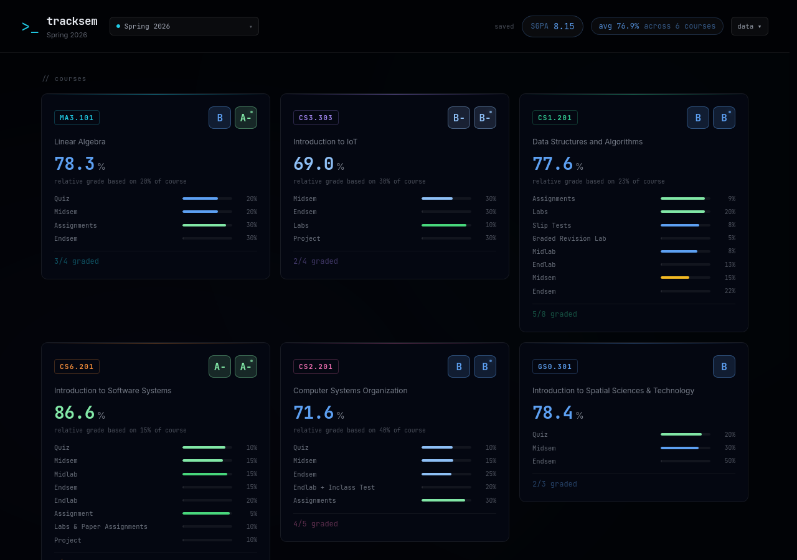
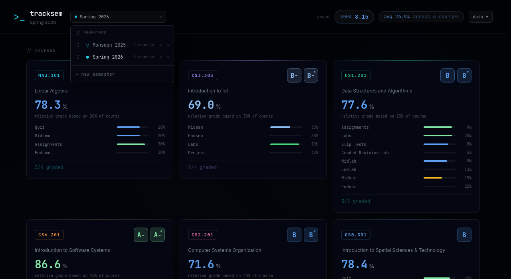
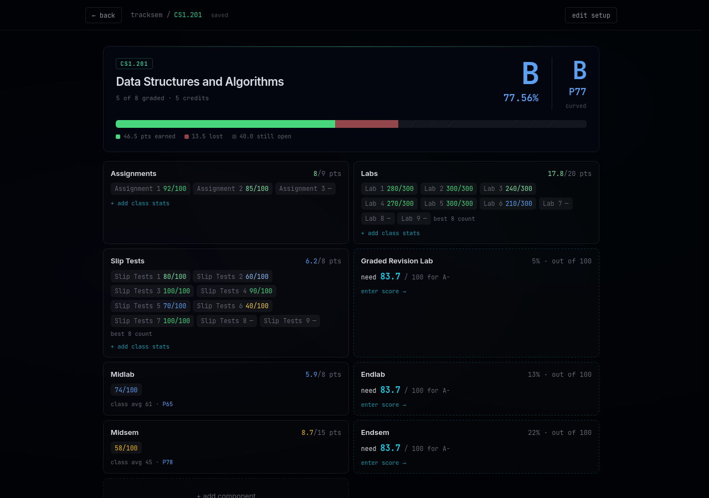
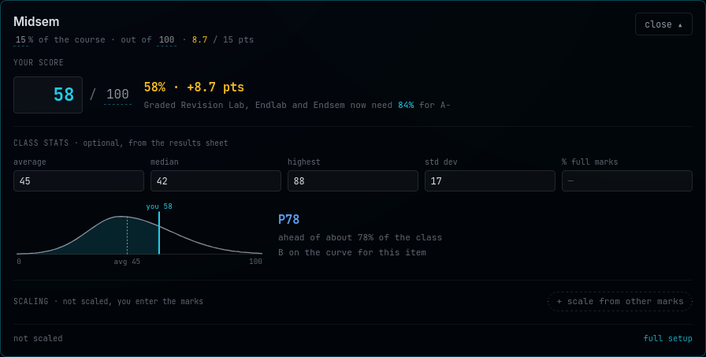
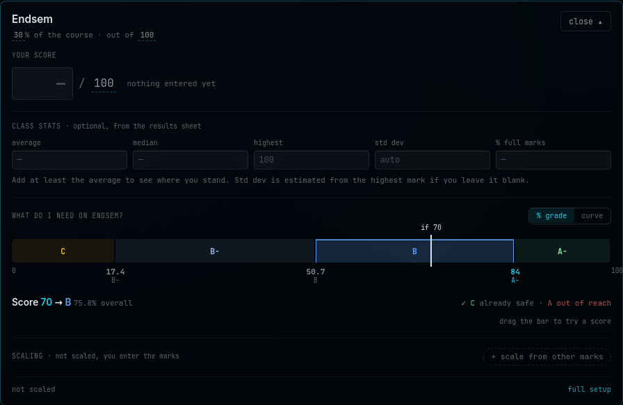
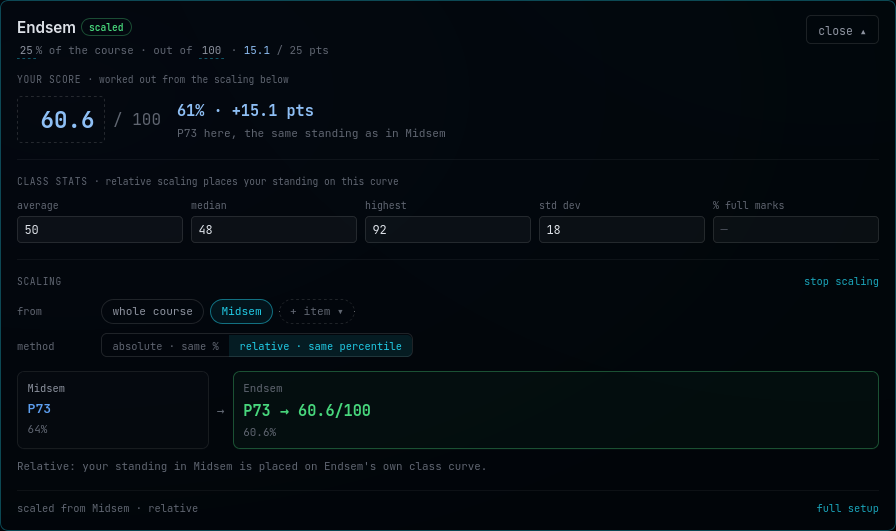
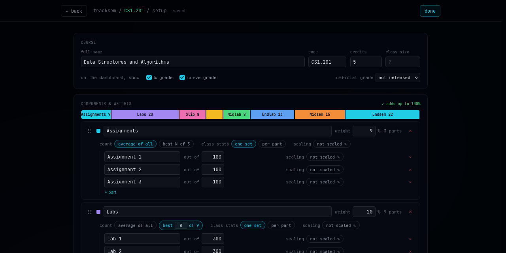
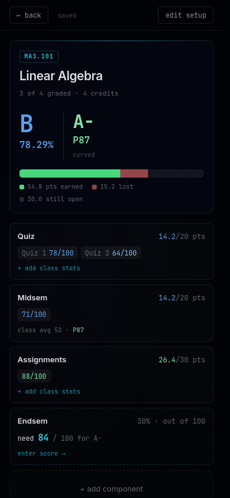
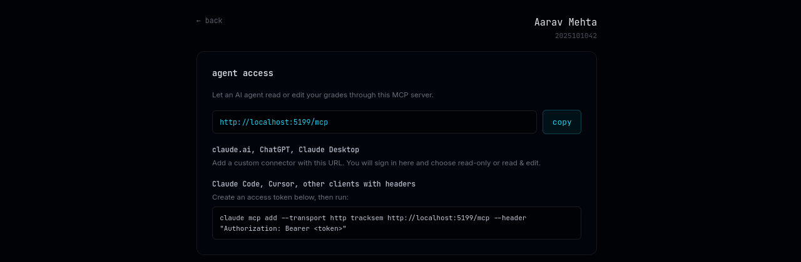

# tracksem

> track your sem grades before they track you

tracksem is a grade tracker for IIIT-H students. Pick your branch and semester and it fills in your courses with their real evaluation breakdowns. Then type in marks as they come out. It tells you what grade you're heading for, where you stand against the rest of the class, and what you need on the next exam.



## What it does

### Your whole semester on one screen

The dashboard has a card for every course. Each card shows your percentage, the letter it maps to, and a second letter for where you'd land on the class curve. The bars show how much of each component you've scored, and the header keeps a running SGPA. Once a course's official grade comes out, enter it and the SGPA uses that grade in place of the guess.

### Every semester, kept

Start a new semester whenever one begins. The old ones stay a click away in the semester menu, where you can rename, reorder or delete them.



### Each course, mark by mark

Open a course to see each component as a card. The bar at the top splits the course into points you've earned, points you've lost and points still up for grabs. Anything not graded yet tells you what you need on it for your target grade. Pick that target in the grade box and every card updates to match.

Quizzes and labs with several parts show each part's score. Courses that count only your best few (say, best 8 of 9 labs) drop the lowest ones on their own.



### Where you stand in the class

Most IIIT-H courses are graded on a curve, so 58% can be a great score or a bad one. Copy the class average, median, highest mark and spread from the results sheet, and tracksem places you on the curve. It tells you roughly what share of the class you beat and what grade that maps to. You don't have to fill in every field. It guesses the missing ones, says which ones it guessed, and warns you if the numbers you gave don't add up.



### What do I need on the endsem?

Click an exam you haven't taken yet to get a bar of grade bands. Each band shows the score you need to reach that grade. Drag along the bar to try a score and see where it lands you overall. The panel also tells you which grades are already safe and which are out of reach. Switch it to "curve" to see the same thing for the curved grade.



### Scaled marks

Some courses scale one exam from another, such as an endsem that's marked relative to the midsem. Tell tracksem where an item's marks come from (one item, several, or the whole course) and how to carry them over. It can copy your percentage, or put you at the same position on the new exam's class curve.



### Set it up the way your course is graded

Every course starts from its real curriculum breakdown. If your instructor changes things, open "edit setup" to rename components, change weights, add parts, set best-of-N rules or enter the official grade. The coloured strip at the top shows the weights at a glance and tells you when they don't add up to 100%. "Reset to defaults" puts the original breakdown back.



### Built for your phone



The layout works on a phone, so you can enter a score the moment a result goes up. You can also add tracksem to your home screen like an app.

Edits save as you type. If a save fails you'll see it, along with a button to retry. Deleted something by mistake? You have a few seconds to undo. If you try to close the tab while a change is still saving, tracksem asks first.

<br clear="right">

### Ask an AI about your grades

You can connect tracksem to Claude, ChatGPT, Cursor or any other AI app that supports MCP, then ask things like "what do I need on the DSA endsem for an A-?" or "I got 42/50 on the CSO quiz, put it in." Give it read-only access, or let it make edits too. Every edit it makes shows up in a log on your account page with an undo button, and any tab you have open updates straight away.



### Your data is yours

- Download everything as JSON, or as a database file holding only your account.
- Import a JSON export to get your semesters back. It adds them as new semesters and never overwrites anything.
- Change your password from the account page. That signs you out on your other devices.

## Grade scale

The percentage grade uses the absolute cutoffs:

| Letter | Points | You need |
| ------ | ------ | -------- |
| A      | 10     | 90%      |
| A-     | 9      | 80%      |
| B      | 8      | 70%      |
| B-     | 7      | 60%      |
| C      | 6      | 50%      |
| C-     | 5      | 40%      |
| D      | 4      | 33%      |
| F      | 0      | below 33% |

The curved grade goes by your percentile in the class: A from the 90th, A- from the 80th, B from the 65th, B- from the 50th, C from the 35th, C- from the 20th, D from the 10th, and F below that.

SGPA weights each course by its credits. It uses the official grade if you've entered one, and the projected curved grade if not. Courses whose grades you've hidden are left out.

## Running it yourself

tracksem is a SvelteKit app that keeps everything in one SQLite file.

```bash
bun install
npm run dev        # http://localhost:5173
```

Development uses `data/dev.db`, which is created on first run, so you can't touch real data by accident. `npm test` runs the tests and `npm run check` type-checks the project.

The sections below cover running it in production.

<details>
<summary>Deploying with Docker</summary>

Create `data/` and a `.env` next to `compose.yaml`:

```dotenv
TRACKSEM_BIND_IP=127.0.0.1
TRACKSEM_PORT=3173
TRACKSEM_ORIGIN=https://grades.example.com
TRACKSEM_BASE_PATH=/tracksem
```

```bash
mkdir -p data
docker compose up -d --build
```

The container listens on `127.0.0.1:3173` only. `data/` is mounted from outside the container, so rebuilds keep your grades, and it must be owned by UID 1000. Database migrations run on startup. Take a backup before deploying a new version. To update, copy the source over (leave out `.env` and `data/`) and run `docker compose up -d --build` again.

| Variable                 | Default                                                          | Purpose                                                             |
| ------------------------ | ---------------------------------------------------------------- | ------------------------------------------------------------------- |
| `TRACKSEM_DB_PATH`       | `data/tracksem.db` in production, `data/dev.db` otherwise        | Where the SQLite file lives                                         |
| `ORIGIN`                 | none                                                             | Public URL. Its host is allowed automatically                       |
| `TRACKSEM_ALLOWED_HOSTS` | none                                                             | Extra hostnames allowed in the `Host` header, comma-separated       |
| `TRACKSEM_BASE_PATH`     | none                                                             | Sub-path to serve under, such as `/tracksem`. Read at build time    |
| `ADDRESS_HEADER`         | none                                                             | Header with the client IP behind a proxy, used for signup limits   |

The app answers 403 to any request whose `Host` isn't localhost, the `ORIGIN` host, or one listed in `TRACKSEM_ALLOWED_HOSTS`. This blocks DNS rebinding.

</details>

<details>
<summary>Serving under a sub-path</summary>

Set `TRACKSEM_BASE_PATH` (for example `/tracksem`) to serve the app under a path, and rebuild, since it's read at build time. Your reverse proxy should forward that path to the container with the prefix kept, as in `https://grades.example.com/tracksem` to `http://127.0.0.1:3173/tracksem`.

AI connectors look for OAuth metadata at the root of the host. When the app lives under a sub-path, forward these paths to it as well:

| Public path                                              | Forward to                                                    |
| -------------------------------------------------------- | ------------------------------------------------------------- |
| `/.well-known/oauth-protected-resource/tracksem/mcp`     | `/tracksem/.well-known/oauth-protected-resource/mcp`          |
| `/.well-known/oauth-authorization-server/tracksem`       | `/tracksem/.well-known/oauth-authorization-server`            |
| `/.well-known/openid-configuration/tracksem`             | `/tracksem/.well-known/openid-configuration`                  |

For uptime checks, use `/api/health`. It's the only API route that works without signing in.

</details>

<details>
<summary>Accounts and security</summary>

Passwords are hashed with scrypt. Sessions last 30 days, renew while you use the app, and live in an `HttpOnly`, `Secure` cookie. The database only stores a hash of each session token. Every request checks that the data belongs to you, so another account's ids act like they don't exist. Failed logins are capped at 10 per roll number every 15 minutes.

To create an account from the shell, or to hand semesters from before accounts existed to an account:

```bash
docker exec tracksem node scripts/create-user.mjs --name "Full Name" --roll 2025115017 --claim
```

This prints a random temporary password unless you set `TRACKSEM_NEW_PASSWORD`.

</details>

<details>
<summary>Connecting AI agents (MCP)</summary>

The MCP server is at `/mcp` under your tracksem URL, such as `https://grades.example.com/tracksem/mcp`. The account page shows this URL and manages access.

- In claude.ai, ChatGPT or Claude Desktop, add a custom connector with that URL. It sends you to a tracksem page where you approve read-only or read & edit access. Disconnecting it from the account page cuts it off.
- In Claude Code, Cursor, or anything else that can send a header, create an access token on the account page and pass it as a bearer token:

  ```bash
  claude mcp add --transport http tracksem https://grades.example.com/tracksem/mcp \
    --header "Authorization: Bearer tsm_pat_..."
  ```

Agents can list semesters and courses with their computed grades, SGPA and CGPA. They can also answer "what do I need" questions, browse the curriculum, edit scores, weights, class stats and courses, add or delete items, and undo changes. With read-only access, the editing tools are hidden. Each token or connection gets 600 requests every 10 minutes. The database stores only hashes of tokens, and the database download strips them out.

</details>

<details>
<summary>Backups</summary>

`scripts/backup.sh` takes a consistent snapshot of the running container's database and saves it to `data/backups/tracksem-<UTC timestamp>.db`. It keeps the newest 30 snapshots.

```bash
scripts/backup.sh                       # TRACKSEM_CONTAINER=tracksem KEEP=30 by default
```

To run it every night with cron:

```cron
15 3 * * * /path/to/tracksem/scripts/backup.sh >> /path/to/tracksem/data/backups/backup.log 2>&1
```

Or with a systemd user timer:

```ini
# ~/.config/systemd/user/tracksem-backup.service
[Service]
Type=oneshot
ExecStart=/path/to/tracksem/scripts/backup.sh

# ~/.config/systemd/user/tracksem-backup.timer
[Timer]
OnCalendar=*-*-* 03:15
Persistent=true

[Install]
WantedBy=timers.target
```

```bash
systemctl --user enable --now tracksem-backup.timer
```

To restore, stop the container and replace `data/tracksem.db` with a snapshot. Delete any `tracksem.db-wal` and `tracksem.db-shm` files, then start the container again.

</details>

## Built with

[SvelteKit](https://svelte.dev/docs/kit) with Svelte 5, Tailwind CSS v4, SQLite through `better-sqlite3`, and [Bun](https://bun.sh) for installing packages. The production image runs on Node 22.
